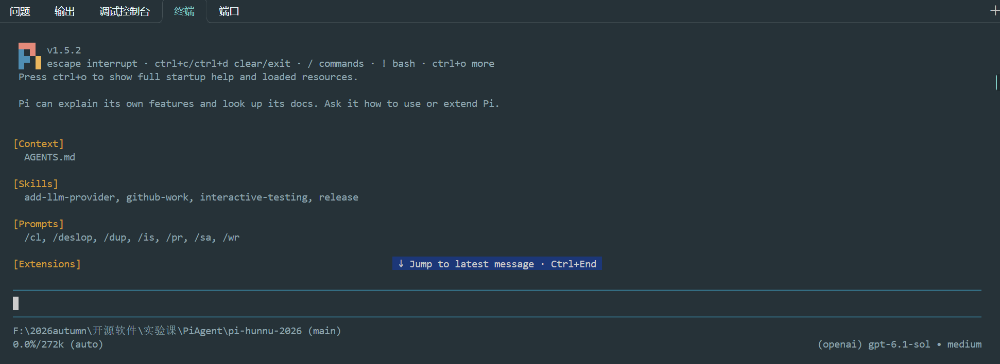

# 实验三：Pi Agent 源码获取、依赖安装与本地编译

## 一、实验目的

1. 检查 Node.js、npm 和 Git 的版本，确认本地开发环境。
2. 了解 Pi Agent 的源码目录、工作区和构建配置。
3. 在仓库根目录安装依赖，理解安装命令的作用。
4. 构建项目，检查 `dist` 产物，并尝试使用本地程序进行会话。
5. 记录实验中出现的提示和仍需要补充验证的问题。

本次实验侧重配置源码开发环境。安装依赖和编译项目不会在本地部署大模型权重。

## 二、检查开发工具

在 PowerShell 中执行以下命令，查看当前终端能够使用的工具版本：

```powershell
node --version
npm --version
git --version
```

截图中的结果如下：

| 工具 | 实际版本 | 本次用途 |
| --- | --- | --- |
| Node.js | `v24.16.0` | 运行 JavaScript 和项目脚本 |
| npm | `11.13.0` | 安装依赖和运行构建命令 |
| Git | `2.55.0.windows.2` | 获取和管理源码 |


**图 1　检查 Node.js、npm 和 Git 版本**

项目根目录的 `package.json` 中，`engines.node` 写的是 `>=22.19.0`。本机截图中的 Node.js 24 满足这个根项目要求，也符合实验指导书推荐的 Node.js 24 系列。工作区内的依赖可能有各自的要求，还要结合安装输出检查。


**图 2　项目根配置中的 Node.js 版本要求**

## 三、源码目录与来源

本次使用上一次实践中已有的源码目录：

```text
F:\2026autumn\开源软件\实验课\PiAgent\pi-hunnu-2026
```

之前保存的仓库信息截图显示，本地分支为 `main`，跟踪 `origin/main`，`origin` 指向：

```text
https://github.com/hunnuOpenSourceSoftware2026/pi-hunnu-2026.git
```

本次整理报告时，在该本地仓库中查询到的完整提交编号是：

```text
c3cc91632d0a1950fb122605b190233f2aa0006e
```


**图 3　上次实践保存的本地仓库信息**

实验要求使用小组组织内的 fork。当前检查到的 `origin` 是课程组织仓库地址，还需要核对小组仓库的实际情况，并按要求使用小组仓库源码。图 3 显示的是短提交编号；完整编号来自本次整理时的 `git rev-parse HEAD` 查询，截图中没有单独展示完整编号。

## 四、阅读项目配置

在 VS Code 中查看根目录的 `package.json`、`package-lock.json` 和 `packages/`。根项目使用 npm workspaces 管理多个包，`package-lock.json` 用来记录依赖版本和依赖关系。


**图 4　根目录 package.json 中的 build 脚本**

Node.js 的版本要求写在根目录 `package.json` 的 `engines.node` 中。执行 `npm run build` 时，npm 读取当前目录的 `package.json`，找到 `scripts.build` 并执行其中的命令。根脚本会依次进入多个子包，再运行子包自己的构建脚本；命令之间的 `&&` 表示前一步成功后才继续。

从项目配置可以看出，根脚本依次构建 `telemetry`、`schema`、`chord`、`tui`、`codemode`、`mcp`、`ai`、`durable`、`env`、`agent` 和 `coding-agent`。其中 `ai` 的普通构建会生成模型目录数据，`coding-agent` 还会复制资源并打包。图 4 由于横向空间有限，只显示了脚本的开头。

## 五、安装项目依赖

在源码仓库根目录执行：

```powershell
npm install --ignore-scripts
```

这个命令根据 `package.json` 和 `package-lock.json` 安装项目依赖，准备 `node_modules` 等依赖目录，并处理工作区包之间的关联。`--ignore-scripts` 用来跳过安装期间自动执行的生命周期脚本，后面仍然可以主动运行 `npm run build`。这里没有使用 `-g`，所以安装的是项目依赖。


**图 5　依赖安装输出**

截图中的本次安装输出显示新增 333 个包、审计 356 个包，并显示 `found 0 vulnerabilities`。安装结束后终端返回了提示符。这个结果表示该次审计没有报告已知漏洞，不能代替构建结果；截图也没有单独显示命令退出码。

## 六、本地构建与产物检查

实验要求在仓库根目录运行：

```powershell
npm run build
```

根构建脚本会依次调用各子包的构建命令，大多数子包使用 TypeScript 编译器生成 `dist`。`ai` 的普通构建还需要准备模型目录数据，这些数据是模型配置和能力信息，不是模型权重。

图 6 显示了构建末尾的 `coding-agent` 编译、资源复制和打包输出，最后出现 `Built packages\coding-agent\dist\bundle`，显示打包生成了 84 个文件。接着检查并运行入口文件：

```powershell
Test-Path .\packages\coding-agent\dist\bundle\cli.js
node .\packages\coding-agent\dist\bundle\cli.js --version
```

第一条返回 `True`，第二条输出 `1.5.2`，说明当时该路径下的 CLI 文件存在，并且可以输出版本号。


**图 6　构建输出和本地 CLI 产物检查**

图 6 没有显示根构建命令本身及其退出码，因此可以确认打包末尾输出和产物运行结果，但不能仅凭截图核实根构建命令的完整执行过程和退出码。按 S5 要求，还需要补充包含根构建结束及退出码 `0` 的截图。下次操作时可在 `npm run build` 执行结束后立即查看 `$LASTEXITCODE`，再检查入口文件。

## 七、启动 Pi 并进行会话

实验要求在仓库根目录通过以下命令启动本地源码入口：

```powershell
.\pi-test.bat --version
.\pi-test.bat
```

查看本地 `pi-test.ps1` 可以看到，它通过 Node.js 加载项目内的源码解析器，并运行 `packages/coding-agent/src/cli.ts`。因此，在仓库根目录使用这个入口，可以将它与直接运行系统中的全局 `pi` 命令区分开。

现有截图显示 Pi 界面版本为 `v1.5.2`，工作目录为本地源码仓库：



**图 7　Pi 界面与本地工作目录**

在会话中输入“请用一句话说明源码和编译产物的区别。只回答问题，不修改文件”，模型返回了实际回复：


**图 8　模型会话结果**

这两张截图展示了 Pi 界面、工作目录、提示词和模型回复，但没有截到 `.\pi-test.bat` 的启动命令。仅凭工作目录和版本号，还不能确认当时启动的是源码入口；需要补充从该命令启动到会话的终端截图。

源码入口适合在开发过程中检查项目源码的运行情况；`dist/bundle/cli.js` 是构建后生成的打包入口，适合检查构建产物能否运行。修改程序时应修改 `src` 下的源码，再按需要重新构建，避免直接修改可能被覆盖的 `dist` 文件。

## 八、遇到的提示与处理情况

### 1. npm 配置警告

安装和构建输出中都出现了 `Unknown project config "min-release-age-exclude"`，构建输出还出现对应的环境配置警告。当前截图中的安装继续输出了汇总，后面的截图也显示了打包输出，因此这些警告在所展示的过程中没有阻止后续结果出现。

这类提示需要结合项目配置和当前 npm 版本查看，不能直接当作构建失败。截图没有记录专门修改配置或消除警告的过程，本次没有把它写成已解决的问题。

### 2. 依赖弃用提示

安装时出现 `prebuild-install@7.1.3` 和 `node-domexception@1.0.0` 的 `deprecated` 提示，说明相关依赖包存在弃用或维护状态提示。截图中的安装仍然给出了汇总结果。没有证据表明本次对依赖版本进行了修改，也没有执行 `npm audit fix --force`。

### 3. 截图顶部残留的 npm 错误

图 5 顶部还有一条前一次 npm 运行留下的错误日志路径，但截图没有包含完整报错内容，也没有显示前一次执行的命令。后面重新执行 `npm install --ignore-scripts` 后，截图显示了安装汇总。

目前不能判断前一次错误的原因，也不能说重试已经解决了某个具体问题。需要查看当时的完整日志或补充错误截图，才能进一步分析原因和记录解决过程。这部分是实验要求中的重点，提交前应尽量补充真实的排错记录。

### 4. 源码来源与截图证据

检查时发现，本地 `origin` 指向课程仓库，和作业要求的小组组织 fork 不一致。需要先确认小组仓库地址，再按要求检查或获取小组仓库源码，并补充显示目录、远程地址、分支和完整提交编号的截图。对于构建退出码和源码入口启动命令，也需要补充截图，才能完整对应 S5、S6 要求。

## 九、实验体会

这次实验让我把依赖安装、项目构建和运行产物几个步骤区分开了。`npm install --ignore-scripts` 负责准备项目依赖；`npm run build` 按项目脚本构建多个包；运行 `dist/bundle/cli.js --version` 则用于检查生成的入口文件。

看日志时也需要区分警告、审计结果和真正导致命令失败的错误。现有截图记录了安装汇总、打包结果和模型回复，但完整报错、构建退出码及源码启动命令还需要补充，不能只凭某一个成功结果推断所有步骤都通过。
